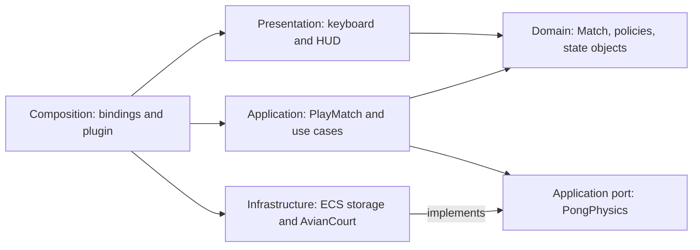
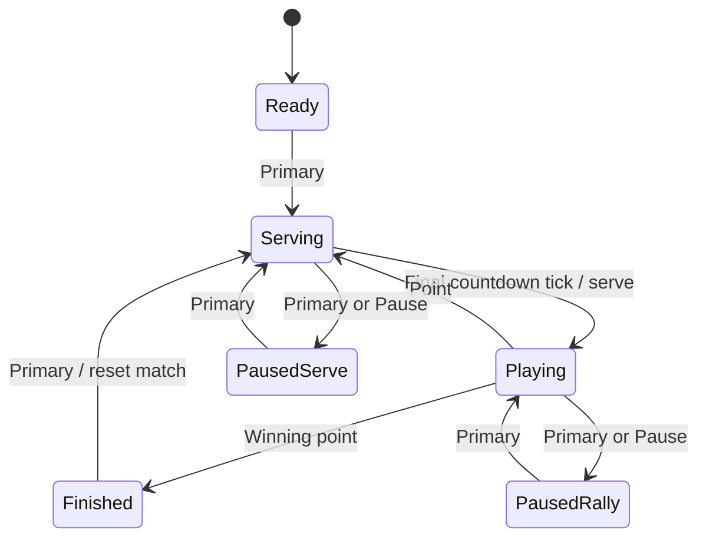

# Understanding this Pong project

Run the game first, then read one section at a time. This guide describes the current Bevy + Avian implementation, including why the game rules remain plain Rust.

## 1. Start with the dependency boundary

The workspace contains two packages:

- `pong`: the executable, depending on Bevy, Avian, and our core library.
- `pong_core`: the rules library, with no external dependencies.

The core owns scoring, serving, the state machine, AI decisions, paddle limits, and the arcade rule that a paddle hit changes the ball's angle and speed. Avian owns physical positions, velocities, integration, contact detection, and wall response. Bevy hosts the ECS, schedules work, reads input, and renders.

```text
Keyboard -> KeyboardControls -> MatchDriver -> ForPlayingPong / PlayMatch
                                                    |
                                                Use cases
                                               /         \
                                      Domain Match      PongPhysics
                                      + pure rules           ^ implements
                                       + states          AvianCourt
                                                             |
                                                      Avian in Bevy ECS
```

`ForPlayingPong` is the driving port, implemented by the application service `PlayMatch`. `PongPhysics` is the driven port used by the application use cases. Both traits belong to `pong_core`'s application layer. `AvianCourt` implements the latter outside the core. The domain `Match` knows neither port.

### Where presentation, application, domain, and infrastructure live

The two Cargo packages provide the engine boundary; folders inside them expose responsibility:

| Layer | Location | What belongs here |
| --- | --- | --- |
| Presentation | `src/game/presentation/` | Keyboard translation, HUD, camera, scene visuals |
| Application | `crates/pong_core/src/application/` | `PlayMatch`, explicit use cases, and physics orchestration through ports |
| Domain | `crates/pong_core/src/domain/` | `Match`, scores, serve policy, state objects, bounce and movement policies, values |
| Infrastructure | `src/game/infrastructure/` | Avian integration, physics-to-transform synchronization, and ECS storage |
| Composition | `src/game/composition/` | Input/tick/view bindings, factories, startup assembly, and schedule wiring |

The application layer is ordinary Rust. `MatchResource` is only a Bevy wrapper that stores its `Match`; it contains no gameplay logic or systems. Presentation does not import this wrapper, `AvianCourt`, or any other infrastructure type. Infrastructure does not import presentation, and neither layer imports composition.

Composition owns the concrete connections. `MatchDriver` binds queued input and fixed ticks to the application and its `AvianCourt` physics implementation. `PresentationBindings` supplies ordinary core values to the view: a `Mode` for keyboard interpretation and a borrowed `Match` for HUD updates. Presentation still uses Bevy's input, queries, text, and meshes because Bevy is also our UI framework; it has no Avian dependency.



The arrows above describe code dependencies. At runtime the use cases call their `PongPhysics` parameter, which is an `AvianCourt` in the game or a `PhysicsMock` in core tests. The domain receives ordinary values and returns decisions; it never calls physics. The core never imports the concrete adapter.

For example, the binding calls `hud.update(&game.0)`. Only that binding knows `game` is a Bevy `MatchResource`; the HUD sees `&pong_core::Match`. `Hud` groups its own label queries and previous display snapshot with `#[derive(SystemParam)]`, so those UI details remain private. No extra trait is needed merely to pass existing core data. The binding borrows the match directly, without maintaining another copy or a second state machine.

### Finding the application use cases

Open `application/match_play/use_cases/` inside `pong_core`:

- `handle_match_action.rs`: `HandleMatchAction` submits a typed action to the domain and applies the resulting effect.
- `move_paddles.rs`: `MovePaddles` reads physical observations, calls movement policies, and requests velocities.
- `bounce_ball.rs`: `BounceBall` coordinates a paddle contact with the bounce policy and physics port.
- `advance_match.rs`: `AdvanceMatch` supplies the post-physics ball position to `Match` and applies its scoring or countdown decision.

`application/match_play/play_match.rs` contains `PlayMatch`, the common entry point implementing `ForPlayingPong`. It only borrows `&mut Match`; it does not own scores or implement transitions. `match_effects.rs` contains the shared executor for domain decisions: resetting the court, resetting the ball, or setting serve velocity. The physics port remains in `application/physics/pong_physics.rs`.

The corresponding domain owner is `domain/match_play/pong_match.rs`. It keeps scores, mode, serve direction, and the state machine together. All match mutations go through the application entry point; the HUD only reads its public observations. Starting play looks like this:

```rust
PlayMatch::new(&mut game).act(Action::Primary, &mut physics);
```

That calls `HandleMatchAction`, which asks the domain to handle the action. `ReadyState` chooses the transition to `ServingState`. Later, the final countdown tick produces `ServeBall`, and the application requests the velocity through `PongPhysics`. Each layer has a distinct job in this path.

### Why the adapter was split

`infrastructure/avian/avian_court.rs` translates the physics port into component reads and writes. `paddle_contacts.rs` handles the opposite direction: it translates engine contacts into `PaddleHit` values and invokes the application. `previous_position.rs` owns fixed-tick position snapshots. The same infrastructure folder contains `body_interpolation.rs`, which converts Avian positions and their history into Bevy transforms. This is engine-to-engine synchronization; it does not decide HUD content or scene appearance.

Resetting a body still resets its physical history in `AvianCourt`. Those writes belong together: a teleport must not interpolate from the previous location. `AvianCourt` never changes a `Transform`; the separate `BodyInterpolation` system does that. Neither imports presentation code.

An adapter translates our vocabulary into the provider's API. This is the Adapter pattern within ports-and-adapters architecture. We do not need a separate Bridge hierarchy. Changing the provider would require a new adapter and scheduling integration, while retaining the core's contract and rules.

There is one Bevy world. The adapter borrows its components; it does not create an inner Bevy app, serialize a world, or run a second simulation. `BallMotion` is a small observation returned when rules need to inspect the ball, not another authoritative body.

## 2. Cargo, packages, crates, and modules

`Cargo.toml` describes a package and its dependencies. The root manifest also declares the workspace. `Cargo.lock` records resolved versions and belongs in Git for this application.

A crate is a compilation unit. The executable starts at `src/main.rs`; the library starts at `crates/pong_core/src/lib.rs`. A package can have multiple crate targets, including tests.

`mod game;` declares a module. Rust loads `src/game/mod.rs`, whose `mod composition;` loads `src/game/composition/mod.rs`. That module declares `mod pong_plugin;`, loading its sibling `pong_plugin.rs`. A file belongs to the module tree because of these declarations, not simply because it exists on disk. In this project, `mod.rs` groups related files and exposes selected types, while each type has its own definition file.

`use crate::game::PongPlugin;` brings a name from this crate into scope. `use pong_core::Match;` refers to another crate. Neither statement executes a file.

The core's modules are private, while `lib.rs` deliberately re-exports public types. It exports `ForPlayingPong`, `PlayMatch`, and `PongPhysics` from application, and `Match` plus observation values from domain. Callers still import names such as `pong_core::Match` and `pong_core::PongPhysics`; they do not access internal file paths.

`pub(super)` means visible to the parent module. `pub(in crate::game)` limits visibility to that module and its descendants. Ordinary `fn` helpers remain private to their module and descendants. Rust's privacy is module based, rather than restricting a private method solely to other methods on the same struct.

## 3. Read the physics contract first

Open `crates/pong_core/src/application/physics/pong_physics.rs` for the trait and `crates/pong_core/src/domain/physics/velocity.rs` for the value and its methods. A small value looks like this:

```rust
#[derive(Debug, Default, Clone, Copy, PartialEq)]
pub struct Velocity {
    pub x: f32,
    pub y: f32,
}
```

`struct` defines named fields. `f32` is a 32-bit floating-point number. `pub` allows callers to read or construct these observations. `derive` generates standard trait implementations: debug formatting, zero defaults, copying, and equality comparisons.

`impl Velocity` supplies a `speed(self)` method. It consumes a copy of this small value and calculates the vector's length with `hypot`. The final expression needs no semicolon when it is the return value.

A trait describes available behavior. `PongPhysics` lets application use cases read ball motion and paddle positions, request velocities, and reset bodies. It exposes neither Avian entities nor Bevy vectors. It is intentionally specific to Pong, rather than attempting to abstract every feature a physics engine offers.

`paddle/paddle_movement.rs` contains `PaddleMovement` and its associated movement policies. The court is 540 units high and each paddle is 96 units high, so its center must remain within `(540 - 96) / 2 = 222`. The core limits the requested velocity so the next step lands on that boundary; Avian performs the movement.

## 4. Ownership and borrowing

An owner controls a value's lifetime. Moving a value transfers ownership; copying is available for types implementing `Copy`.

- `&value` borrows for reading.
- `&mut value` borrows exclusively for modification.
- `let mut value` permits mutation or mutable borrowing.

Rust prevents conflicting access while a borrow is in use. Bevy owns the actual `Position` and `LinearVelocity` components. The `AvianCourt` system parameter borrows them through a query for the duration of one system call.

`AvianCourt<'w, 's>` carries lifetimes describing its world and system-state borrows. These are checked relationships between references, not runtime timers or copies of the world. `#[derive(SystemParam)]` teaches Bevy how to supply the grouped resources and query.

`PreviousPosition` is a snapshot of physical position taken before integration. Neither the core nor Avian reads it to decide how bodies move; infrastructure's interpolation system uses it to synchronize the rendered transform. Resetting a body resets this snapshot too, avoiding a visible streak from the old position to the center.

See [References and Borrowing](https://doc.rust-lang.org/book/ch04-02-references-and-borrowing.html) in the Rust Book.

## 5. Traits, enums, and pattern matching

`impl Plugin for PongPlugin` implements Bevy's `Plugin` trait. `impl PongPhysics for AvianCourt` implements our physics capability. The test suite provides a second implementation, `PhysicsMock`.

`&mut impl PongPhysics` means an exclusive borrow of some concrete type implementing that trait. The compiler specializes these physics-port calls, so that boundary requires no boxed adapter or virtual dispatch. The domain state machine deliberately uses the other mechanism: `Box<dyn State>` stores one concrete state behind its common trait and dispatches its behavior at runtime.

Enums describe alternatives. `Direction` is `Up`, `Down`, or `Still`. `Phase::Finished(Side)` also carries the winner. A `match` handles those variants, with the compiler checking coverage.

`PaddleHit` describes a new contact translated from Avian before its solver runs. `Option<Side>` is used by the scoring rule: a fully departed ball yields `Some(scorer)`, otherwise `None`.

## 6. What ECS does

An entity is an identity; components are data attached to it. Systems operate on matching components and shared resources.

A paddle has an Avian `RigidBody::Kinematic`, `Position`, `LinearVelocity`, and rectangular `Collider`, along with render components. A kinematic paddle follows our requested velocity without being pushed around by the ball. The ball is dynamic, rotation locked, and kept awake. The top and bottom walls are static.

A `Resource` is stored once in the world. `MatchResource` owns match progress. `KeyboardControls` buffers actions and held directions. `CourtEntities` identifies the two paddles and the ball.

`Query<&Position>` requests reads. `Query<&mut Position>` requests exclusive writes. `Res<T>` and `ResMut<T>` do the same for resources. These declarations also let Bevy detect conflicting systems and safely schedule independent work.

All visible rectangles share a unit-square mesh and a small material collection. `Handle<T>` refers to a shared asset; cloning it does not duplicate the mesh. Each physical game piece has an unscaled parent entity and a scaled mesh child. Moving the parent moves its visual child; the child alone carries the mesh's size.

Collider sizes are specified explicitly from the same core constants. Unscaled physics roots keep their initialization scale equal to one. This matters because Avian reads the initial global scale even when later scale synchronization is disabled. Static walls also receive a unit transform. The adapter disables automatic transform-to-collider scaling and transform-to-position synchronization so subsequent visual changes and interpolation cannot alter physical geometry or positions. The geometry test checks this directly.

### Creating complete entities with factories

`PaddleFactory` and `BallFactory` live in `src/game/composition/`, with one structure and its associated functions per file. Their job is to assemble complete engine entities. For example, startup creates a paddle with:

```rust
let paddle = PaddleFactory::spawn(commands, assets, Side::Left);
```

The factory queues a root entity with its identifying component, initial transform, interpolation data, and Avian physics components. It also queues a mesh child with the appropriate material and dimensions, and returns the root's `Entity` handle. `Commands` applies these changes later; returning a handle does not immediately insert the entity into the world. No separate game system needs to add the paddle's physics afterward.

Inside each factory, `spawn_body`, `physics_components`, and `spawn_visual` are private helpers. The physics helper returns `impl Bundle`: a concrete group of components that Bevy can insert together. Its tuple is nested in the root's spawn tuple, so rendering and physics components are attached in the same spawn operation. The bundle describes the component data; the factory owns assembling the root and visual child.

`CourtSetup` is the startup system that builds shared assets, calls the factories, records the handles in `CourtEntities`, and creates the court, HUD, and walls. Composition can depend on rendering and physics because it connects them. Those modules do not depend on composition, and the core knows nothing about these factories or Bevy entities. Factory tests call `spawn` in a fresh world and flush the commands directly, proving that creation is complete without the game's startup systems.

## 7. Follow one frame

1. `DesktopApp::build` configures the window and renderer, adds Bevy's plugins, and adds `PongPlugin`.
2. `CourtSetup::spawn` creates shared assets, the camera and court markings, complete paddles and ball through their factories, the HUD, and static wall colliders.
3. In `PreUpdate`, `PresentationBindings::capture_keyboard` supplies keys, window focus, and the current core mode to `KeyboardControls` after Bevy's input systems. It forwards any quit request to Bevy. One-shot game actions are buffered until a fixed tick consumes them.
4. At 120 Hz, `MatchDriver::prepare_tick` invokes `PlayMatch::act` for queued actions and `PlayMatch::prepare_tick` for movement. These route to `HandleMatchAction` and `MovePaddles`. `PreviousPosition::capture` then records positions before integration; these systems are chained in `PhysicsSystems::First`.
5. Avian runs physics only in `Serving` or `Playing`. After its narrow phase detects contacts, `PaddleContacts::respond` translates new paddle hits and calls `PlayMatch::hit_paddle`, invoking `BounceBall`. The domain policy chooses the outgoing velocity before Avian solves contacts, so simultaneous wall collisions still receive the engine's response.
6. After the solver integrates and resolves motion, `MatchDriver::finish_tick` calls `PlayMatch::finish_tick`, invoking `AdvanceMatch`. The domain updates scoring or the countdown; the application carries out any physics effect.
7. In `Update`, infrastructure's `BodyInterpolation` synchronizes transforms. `PresentationBindings::update_hud` separately supplies the core match to the HUD, which refreshes text when displayed values change. Ready, paused, and finished matches skip integration entirely.

These stages are explicitly ordered with Avian's `PhysicsSystems`. Input can still resume the game while the simulation is stopped.

The final serve-countdown tick sets the ball's velocity after physics. Movement starts on the next tick, preserving the original timing. A scored point returns immediately after starting a new countdown, so it does not accidentally consume the first countdown tick.

Interpolation uses the previous and current physical positions and Bevy's fixed-time remainder. It smooths a 120 Hz simulation on displays with other refresh rates, at approximately one step of visual latency. It never feeds back into physics.

## 8. What Avian does, and what remains a game rule

Avian integrates motion, detects contacts, prevents penetration, and applies solver impulses. Gravity and friction are zero; wall restitution is one so bounces retain speed. Swept continuous collision detection is enabled for the ball to prevent tunneling through thin bodies at high speeds.

The ball is a square, and its collider matches its 16-by-16 visual dimensions. `BALL_RADIUS` is the existing tuning name for its half-size. Paddles use full rectangular colliders. This differs from the previous handmade court-facing-plane collision model: edges and moving paddles now participate in the engine's contact solver.

Pong's arcade paddle response remains a policy on `BallRules` in `ball/ball_rules.rs`:

```text
normalized offset = clamp(hit offset / half paddle height, -1, 1)
angle magnitude = max(abs(normalized offset) * 60 degrees, 12 degrees)
speed = min(incoming speed * 1.07, speed cap)
```

The outgoing horizontal direction faces back into the court. The adapter measures incoming speed before Avian's impulses and applies the arcade velocity before solving contacts. This ordering matters: applying it afterward could overwrite a simultaneous wall reflection and push the ball outside the court. New-contact events prevent applying the increase every frame while bodies touch. The moving-paddle and corner tests protect this integration.

The 12-degree minimum prevents center hits from producing an endless horizontal rally. Hits above or below the paddle center steer in that direction. An exact center hit preserves the incoming vertical direction; an already horizontal ball goes upward. The 60-degree maximum and speed cap still apply. These are arcade rules in the core, not a replacement collision solver.

A ball scores only when its whole square has crossed a side boundary. The core evaluates this rule from the engine's position, increments one score, and resets the ball through the port. Goal sensors are unnecessary for this straight boundary rule.

This is hybrid arcade behavior: Avian handles physical motion and contacts, while the core chooses the special paddle response. It is not a bit-identical replacement of the old solver, nor a deterministic cross-platform lockstep simulation.

## 9. How the tests divide responsibility

| Layer | Location | Evidence |
| --- | --- | --- |
| Core behavior | `crates/pong_core/tests/scenarios/` | Countdown and state transitions, scoring boundaries, AI and player movement, bounce policy, rematches |
| Physics integration | `src/game/infrastructure/avian/tests.rs` | Actual Avian collisions, moving paddles, continuous collision detection, pause/reset integration, full-frame scheduling, a complete match |
| Input and presentation integration | `src/game/tests/input.rs` | Buffered key presses, opposite keys, focus pause, render synchronization, mode instructions |
| Desktop smoke | `src/game/tests/render_smoke.rs` | A real window opens, screenshots are fresh, and paddles and ball produce visible pixels |

`match_flow.rs` collects core scenarios by behavior: lifecycle, movement, scoring, and bounce. Those scenarios call the same public driving port as Bevy. `support/match_fixture.rs` owns `MatchFixture`, which creates a fresh match in a named state through public operations. A fixture is reusable **setup**, not a second implementation of the game.

`support/physics_mock.rs` supplies the hand-written `PhysicsMock` implementation of `PongPhysics`. It returns observations chosen by the test and records commands for explicit assertions. This is a recording test double (also called a spy); `assert_commands` verifies the expected interactions. For example, scoring must issue exactly one `ResetBall`, restarting must issue one `ResetCourt`, and a paused match must issue no physics writes. Getters and internal helper calls are not mocked. The double stores requested motion but never integrates positions or computes collisions, so it cannot prove that Avian works. No mocking dependency is needed in the core crate.

Each scenario uses **Given / When / Then**:

```rust
// Given a local match with an active rally.
let mut fixture = MatchFixture::playing(Mode::Local);
fixture.physics.clear_commands();

// When the player restarts.
fixture.act(Action::Restart);

// Then the match is ready and the court resets exactly once.
assert_eq!(fixture.game.phase(), Phase::Ready);
fixture.physics.assert_commands(&[PhysicsCommand::ResetCourt]);
```

Keep the action and expected result visible in the test. Extract repeated setup and low-level ECS access into fixtures; avoid hiding the assertion inside a scenario builder. Some state-machine scenarios have a second When/Then pair to verify resuming or starting the next rally.

Names explain test data: `DISTANCE_TO_WALL`, `TUNNELING_SPEED`, and `EXPECTED_REBOUND_SPEED` describe why their values matter. Obvious zero values, one tick, vector dimensions, and percent conversion remain literals. Keep expected rule examples independent of the implementation: an incoming speed of 400 must become 428, and a center hit must have at least a 12-degree rebound. Do not call the production bounce function to calculate its own expected result. Pure-rule assertions use a small floating-point tolerance; engine assertions name their separate solver tolerances. Table-driven cases cover both sides, goal boundaries, and vertical directions with fresh fixtures per case.

The engine fixtures in `src/game/tests/support.rs` create a fresh world for every test. `fixed_app()` runs startup once and lets a test advance explicit fixed ticks. `frame_app()` lets `App::update()` own startup and advances a controlled 60 Hz clock through the complete frame schedule. Do not call `App::update()` on a `fixed_app()` fixture: that would run startup again. Regular tests never sleep, access the network, or need a real window. The complete-match test has a simulation-time limit so a broken rally fails instead of looping forever.

Use the cheapest layer that can demonstrate the behavior. Add state-machine and scoring cases to the core suite; add provider and scheduling regressions to the real engine suite. High-risk coverage goals are boundary scoring exactly once, pause/resume state preservation, non-flat rebounds, collision detection at high speed, and correct physics/render synchronization. Every such change should have a focused regression test. We do not claim a measured line-coverage percentage or add tests merely to meet a fixed ratio.

Run `cargo test -p pong_core` during rule changes, then `cargo test --workspace`, formatting, and Clippy before finishing. The ignored desktop smoke test needs a real graphics device and a focused window; run it explicitly after rendering or smoke-test changes. It writes captures under `target`, so run one desktop smoke process at a time. Pixel checks catch missing pieces but do not prove visual layout quality or verify every captured gameplay state. Inspect the screenshots when evaluating appearance.

## 10. Architecture and performance tradeoffs

We chose an adapter over the existing ECS world rather than a separate inner Avian app. An inner app could provide a synchronous `step()` wrapper, but would introduce another world and synchronization responsibilities. Explicit movement, contact-response, and post-physics stages fit Bevy's scheduler directly.

This migration adds an engine dependency and more build cost. For three moving pieces, the previous custom solver was also a valid practical choice. The benefit here is learning and using a maintained physics engine behind a real substitution boundary, not a claim of measured speed improvement.

The adapter performs a few entity lookups and copies small observations. It does not clone a world or allocate a generic command queue each tick. Avian manages its own broad phase, contacts, and solver storage; do not assume the entire engine is allocation free. Profile before pursuing more optimization.

The engine boundary is enforced by the crate manifests and CI's check that `pong_core` has zero dependencies. `scripts/check-architecture.ps1` checks explicit source paths: domain cannot import application, application cannot reach outside the core, infrastructure cannot import presentation or composition, and presentation cannot import infrastructure, Avian, or composition. It complements Rust's module visibility; it is a lightweight source check, not a Rust parser. Physics implementation details stay in `src/game/infrastructure/avian/`. No port is added for rendering because the core does not need to call a renderer.

## 11. Suggested reading order

1. Core `domain/rules.rs`: dimensions, speed, timing, winning score.
2. Core `application/physics/pong_physics.rs` and `domain/physics/`: the port and value types.
3. Core `domain/paddle/paddle_movement.rs` and `domain/ball/ball_rules.rs`: pure arcade policies.
4. Core `domain/match_play/pong_match.rs`, then `state_machine/state.rs` and `state_machine/states/`: match ownership and per-state behavior. `machine.rs` holds and delegates to the current state.
5. Core `application/match_play/play_match.rs`, then `use_cases/`: the entry point and named application workflows.
6. Core `tests/scenarios/` and `tests/support/`: behavior specifications, fixtures, and the physics mock.
7. `game/composition/pong_plugin.rs` and `game/presentation/match_driver.rs`: wiring and application calls.
8. `game/infrastructure/avian/`: engine configuration, physics access, contact translation, and snapshots.
9. `game/composition/court_setup.rs`, `paddle_factory.rs`, and `ball_factory.rs`: startup and complete entity assembly.
10. `game/presentation/input/keyboard_controls.rs`, `court_scene.rs`, and `hud/`: keyboard and presentation.
11. `desktop_app.rs`: desktop composition; `main.rs` simply builds and runs it.

Try changing `MAX_BALL_SPEED`, adding its expected test behavior, then playing. Next change a color or key binding and notice that the core contract stays untouched.

## 12. Everyday commands and debugging

```powershell
cargo check --workspace
cargo test -p pong_core
cargo test --workspace
cargo fmt --all
cargo clippy --workspace --all-targets -- -D warnings
cargo run -p pong
```

For the desktop check: `cargo test -p pong render_smoke -- --ignored --nocapture`. Screenshots are saved in `target/`.

Use breakpoints in `AdvanceMatch::execute` for post-physics orchestration, `Match::award_point` for scoring rules, `PaddleContacts::respond` for translated contacts, or `MatchDriver::prepare_tick` for input. A breakpoint inside a 120 Hz loop triggers frequently.

Windows defaults to DX12 because Vulkan failed on the development machine. An explicit `WGPU_BACKEND` environment variable still overrides it. The rectangles use mesh rendering because the tested sprite path produced incorrect output. These choices live outside the core.

Commit source, manifests, lockfile, tests, and docs. Ignore generated `target/` files and personal `.idea/` settings. No commit is created automatically by these changes.

## 13. Clean code and SOLID here

Private helpers name cohesive work: `MovePaddles::move_right_paddle`, `Match::award_point`, `Match::apply_event`, and `ServingState::advance`. They keep each type's public behavior readable; the four application use cases are separate types because they own distinct workflows and port interactions.

- **Single responsibility:** core policies decide gameplay; the adapter translates and configures Avian; view modules render.
- **Open/closed:** a replacement physics adapter can implement the same port. A new gameplay rule may legitimately require changing the core.
- **Liskov substitution:** implementations must honor the port's units, reset semantics, and timing. The recording mock and real adapter exercise this contract at different test levels.
- **Interface segregation:** `PongPhysics` exposes six operations this game actually consumes, rather than all of Avian.
- **Dependency inversion:** the core defines the capability; the external adapter depends on and implements it.

Good architecture makes changes easier to locate and verify. File count, method length, and the number of interfaces are not quality scores by themselves.

## 14. The game state machine

`domain/match_play/state_machine/` owns the entire lifecycle implementation. `StateMachine` holds a `Box<dyn State>` and delegates each event to the current object. It contains no central switch over states. `state.rs` declares the shared trait, and `states/` contains one struct and its implementation per file:

- `ReadyState` handles the initial start.
- `ServingState` owns the remaining countdown ticks and launch transition.
- `PlayingState` handles pause and the end of a rally.
- `PausedState` retains and resumes the interrupted active state.
- `FinishedState` retains the winner and handles a rematch.

Each state handles restart and ignores irrelevant events. `transition.rs` pairs the next state with a domain effect. `Phase` remains an enum because it is only the read-only status returned to the host and HUD; it does not own transition behavior.



Restart returns any state to Ready, clears scores and bodies, and preserves mode. Switching modes changes the mode and performs that reset. Pause is ignored in ready, finished, or already paused states.

`ActiveState` is a marker trait implemented only by `ServingState` and `PlayingState`. `PausedState` holds a `Box<dyn ActiveState>`, so it can retain either active object but cannot wrap a ready, finished, or paused state. Resuming returns that same object, preserving the countdown without reconstructing it. `State` requires the standard Rust `Send + Sync` traits so the host can store the domain model in a Bevy resource; the domain imports no Bevy types.

Domain effects are `None`, `ResetMatch`, `ResetBall`, and `ServeBall`. `Match` returns `ResetBall` after awarding a point; states request resets or launches through their transition results. `MatchEffects` in application executes these decisions through `PongPhysics`. Avian performs physical integration. Bevy reads `Phase` to gate physics and draw the HUD; it does not maintain a duplicate state machine.

This is the classic State pattern implemented with Rust structs and traits. It is a design choice, not a requirement of Clean Architecture: an enum is also a valid representation for a closed set of states. State objects add virtual dispatch and heap allocations when entering states that carry data. Ordinary countdown ticks mutate and return the existing box, and playing ticks retain their state. The [Rust Book's State-pattern discussion](https://doc.rust-lang.org/book/ch18-03-oo-design-patterns.html) explains the alternatives and ownership mechanics.


## 15. One type per file, organized around the game

The folders expose the architectural layer, then the game concept: for example, `domain/ball`, `domain/paddle`, and `application/match_play`. Each trait has its own file beside the application capability it describes: `application/match_play/for_playing_pong.rs` and `application/physics/pong_physics.rs`. The core remains a separate dependency-free crate, with Bevy and Avian in the desktop host.

Rust's equivalent of a class with behavior is a `struct` plus its `impl` blocks. `domain/match_play/pong_match.rs` contains `Match` and its domain behavior. `application/match_play/play_match.rs` contains `PlayMatch` and `impl ForPlayingPong for PlayMatch`. Each state file likewise contains its struct and `impl State`, with `ServingState` also owning countdown helpers. Trait declarations stay in their own files. An enum and its methods also stay together, as in `domain/controls/direction.rs`.

Objects with no per-instance state, such as `BallRules` or `CourtScene`, use associated functions on a unit struct. Calling `BallRules::serve_velocity(...)` does not allocate an object or add dynamic dispatch. Data-only ECS markers and observation values do not need artificial methods. `PresentationBindings::capture_keyboard` is an associated system function: Bevy supplies its resources and queries. It calls the ordinary `KeyboardControls::capture_keyboard` method with `&mut self` and explicit values. `Hud::update` similarly works on its grouped UI queries and a supplied core match. Components remain data in the ECS; this organization does not replace ECS with an inheritance hierarchy.

Place a new type beside the concept that owns it, keep its behavior in the same file, and expose only what callers need through the parent module. Shared constants stay in `rules.rs` or `palette.rs`. Tests remain ordinary `#[test]` functions and keep their Given/When/Then scenarios. Their fixture and mock types also have separate definition files.

Run `./scripts/check-source-layout.ps1` to check the one-type-per-file convention. CI runs the same check alongside the dependency-boundary check, formatting, behavior tests, and Clippy. The layout script checks explicit declarations in the current source style; Rust visibility and Cargo dependencies enforce the actual boundaries.
